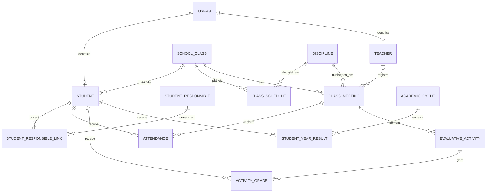

# Modelo de dados do PostgreSQL

Público e responsabilidade — engenharia de backend e de dados

Situação e escopo — esquema resultante das migrações SQL versionadas até a V24

Revisão de referência — backend `6b37a18`, com 23 arquivos SQL versionados em [db/migration](../../db/migration)

## Entidades e relacionamentos

As 27 tabelas de domínio pertencem ao esquema `sisges`. A chave primária é o inteiro `id`, exceto nas tabelas de vínculo e de grade com chaves compostas descritas abaixo. Referências a um usuário identificam a conta de acesso. Referências a professor ou aluno identificam o perfil específico, que tem seu próprio ID. Cada banco contém uma configuração acadêmica comum a toda a escola, sem chave de isolamento por instituição. [Esquema inicial](../../db/migration/V1__create_schema_and_tables.sql) · [Configuração de notas e ciclo](../../internal/api/grading.go)



### Contas, matrículas e currículo

| Tabela | Chaves, finalidade e relacionamentos |
| --- | --- |
| `users` | Uma identidade por conta, com `email` e `register` únicos, hash bcrypt da senha, nome, data de nascimento, gênero, papel e caminho opcional da imagem de perfil. O SQL aceita ADMIN, TEACHER e STUDENT. A exclusão lógica mantém os dois valores únicos reservados. |
| `student`, `teacher` | Cada tabela tem uma chave estrangeira `user_id` única. A exclusão física da conta exclui o perfil em cascata. O campo `class_id` do aluno indica a turma atual e pode ser nulo. A exclusão física da turma torna esse campo nulo. O cadastro cria o perfil correspondente ao papel do usuário na mesma transação. |
| `student_responsible`, `student_responsible_link` | O responsável tem nome, telefone e e-mail principais e contatos alternativos opcionais. A chave primária do vínculo é `(student_id, responsible_id)`. As duas chaves estrangeiras propagam a exclusão física ao vínculo. Um aluno pode ter vários responsáveis, e um responsável pode atender a mais de um aluno. O cadastro do responsável serve para contato, sem papel de acesso próprio. |
| `document_type`, `student_document` | Os tipos de documento têm nomes únicos. Cada aluno pode ter vários registros de metadados, cada um com um tipo e, opcionalmente, número, órgão emissor e data de emissão. O esquema atual já não contém a coluna antiga do caminho do arquivo do documento. |
| `school_class` | Combinação única de `(name, academic_year)` e campo `schedule_revision`, inicialmente zero. O valor de `academic_year` identifica a série em até 30 caracteres, por exemplo, `6º ano`. O ciclo acadêmico guarda o estado do ano letivo. |
| `discipline`, `discipline_teacher` | Os nomes das disciplinas são únicos. A chave primária `(discipline_id, teacher_id)` da tabela de vínculo permite associar mais de um professor à disciplina. |
| `teacher_class`, `class_discipline` | As chaves primárias compostas são `(teacher_id, class_id)` e `(class_id, discipline_id)`. Ambas permitem exclusão lógica do vínculo. Ao associar o professor e as disciplinas selecionadas à turma, a aplicação cria ou reativa os vínculos em uma única transação. A atribuição de aulas deriva dessas relações e de `discipline_teacher`. |
| `lesson`, `discipline_material` | `lesson` é um item do conteúdo programático de uma disciplina, com posição na sequência. `discipline_material` guarda título, descrição, tipo e, opcionalmente, caminho do arquivo, professor e turma. Materiais e aulas realizadas em uma data têm registros e identificadores próprios. |
| `user_logs` | Os códigos de ação de 0 a 4 representam exclusão, criação, atualização, entrada e saída do usuário, respectivamente. As migrações definem a tabela. Nesta revisão, a aplicação Go não dispõe de um mecanismo geral de gravação dessas ações. |

[Contas e currículo](../../db/migration/V1__create_schema_and_tables.sql) · [Exclusão lógica e registros de ações](../../db/migration/V3__school_class_year_only_soft_delete_user_logs_remove_file_path.sql) · [Vínculos de responsáveis](../../db/migration/V5__student_multiple_responsibles.sql) · [Professores por disciplina](../../db/migration/V8__discipline_teacher_many_to_many.sql) · [Abrangência dos materiais](../../db/migration/V10__discipline_material_file_class_teacher.sql) · [Vínculo atômico de professor](../../internal/api/class_teacher.go)

### Aulas, avaliações e comunicação escolar

| Tabela | Chaves, finalidade e relacionamentos |
| --- | --- |
| `class_schedule` | Disciplina recorrente por turma, dia da semana e horário. A chave primária é `(class_id, weekday, slot)`. O SQL limita o dia da semana a 1–5 e o horário a 0–4. As chaves estrangeiras de turma e disciplina, isoladamente, não garantem o vínculo entre elas. |
| `class_meeting` | Cada aula realizada tem turma, disciplina, data, início e término obrigatórios e professor opcional. O registro inclui `schedule_slot` anulável, conteúdo em texto e anexos em JSONB, com lista vazia por padrão. Um índice único parcial cobre `(class_id, meeting_date, schedule_slot)` nas aulas ativas com horário não nulo. Em aulas antigas de cadastro manual, o horário na grade é nulo. |
| `attendance` | Uma linha por combinação única de `(class_meeting_id, student_id)`, com indicador de presença e data de exclusão lógica. |
| `evaluative_activity` | Cada atividade pertence a uma aula. Guarda trimestre opcional de 1 a 3, tipo, pontuação máxima, caminho opcional de arquivo, indicador de liberação, data de liberação e usuário responsável pela liberação, se houver. |
| `activity_grade` | Combinação única de `(activity_id, student_id)`. A nota pode ser nula e tem tipo numeric(8,2). Quando preenchida, o SQL exige valor não negativo. Excluir fisicamente a atividade ou o aluno exclui as respectivas notas em cascata. |
| `grading_config` | Pontuação máxima anual e por trimestre, percentuais mínimos e distribuição de pontos entre provas, atividades e trabalhos. A aplicação lê e atualiza a linha de menor ID. |
| `academic_cycle` | Datas de início e fim, trimestre de 1 a 3, indicador de bloqueio das notas e registros de data e hora. Os estados permitidos são `NOT_STARTED`, `IN_PROGRESS` e `FINISHED`. A aplicação também seleciona a linha de menor ID. |
| `student_year_result` | A combinação única `(academic_cycle_id, student_id)` guarda pontuação base, final e de recuperação anual, indicadores de aprovação e promoção, turma de origem e turma de destino opcional. A chave de origem restringe a exclusão física. A de destino usa SET NULL. |
| `announcement` | Aviso de texto ou imagem com autor e caminho de imagem opcionais, datas de vigência e papéis em campos separados por vírgula. O mural consulta a janela de visibilidade e `hidden_for_roles`. O campo legado `target_roles` continua disponível como metadado. |
| `announcement_like`, `announcement_comment` | Ambas referenciam usuário e aviso. Há no máximo uma curtida por aviso e usuário. O comentário tem texto próprio e data de exclusão lógica. A exclusão física do aviso se propaga às duas tabelas. |
| `school_event` | Exige criador, título, data e hora e público-alvo. O SQL exige turma para `CLASS` e turma nula para `ALL` ou `TEACHERS`. A rota valida o período permitido pelo ano civil no fuso horário de São Paulo. |

[Grade horária](../../db/migration/V24__weekly_timetable_and_lesson_records.sql) · [Avaliações](../../db/migration/V18__grade_domain_and_academic_cycle.sql) · [Resultados anuais](../../db/migration/V19__student_year_result.sql) · [Consulta do mural](../../internal/api/content.go) · [Eventos](../../db/migration/V22__user_profile_image_and_events.sql) · [Datas de eventos](../../internal/api/event_date.go)

## Invariantes e limites das transações

| Regra | Onde é aplicada |
| --- | --- |
| Perfil por papel e responsável no cadastro do aluno | O cadastro valida os dados, obtém um bloqueio por prefixo de matrícula com `pg_advisory_xact_lock` e grava usuário, perfil e vínculo com o responsável em uma transação. O SQL também impõe os papéis permitidos, a integridade referencial e a unicidade das chaves. [Cadastro](../../internal/api/users.go) |
| Uma gravação por vez na grade semanal de cada turma | O bloqueio da linha da turma serializa as gravações da grade e dos registros de aula. Uma revisão desatualizada é rejeitada antes da substituição dos horários. Uma nova aula exige vínculos ativos, disciplina correspondente e ausência de sobreposição com outra aula ativa. Na edição, a aplicação verifica se o professor é o responsável e se a disciplina corresponde à registrada. [Grade e aulas](../../internal/api/schedules.go) |
| Notas e liberação | A operação de lançamento verifica se o aluno pertence à turma e se a nota informada respeita o máximo da atividade. Em seguida, insere ou atualiza os lançamentos em uma transação. A leitura do indicador de liberação ocorre antes da transação. A rota de liberação atualiza diretamente a atividade. As duas operações não compartilham um bloqueio de liberação quando executadas em paralelo. [Lançamento de notas](../../internal/api/activities.go) |
| Resultados e repetição do encerramento | O encerramento do ano lê até 10.000 alunos matriculados, aplica a promoção e grava os resultados na mesma transação. A mudança do ciclo para FINISHED ocorre em outra atualização. Se já há resultados para o ciclo, a apuração termina sem recalculá-los. Iniciar outro ano atualiza o mesmo ciclo de menor ID. Para processar o histórico de vários anos com segurança, cada ciclo precisaria de uma identidade distinta. [Transições do ciclo](../../internal/api/grading.go) · [Apuração dos resultados](../../internal/api/report.go) |
| Política de notas e histórico | O SQL inicializa as colunas de percentual mínimo. O cálculo do boletim e da promoção utiliza 70% da pontuação máxima configurada nas regras correspondentes de recuperação e aprovação. O boletim agrega dados da turma atual do aluno. A atividade não tem chave estrangeira para o ciclo. Usar o boletim como histórico arquivado por ciclo exigiria outra consulta ou modelagem. [Configuração inicial](../../db/migration/V14__grading_config.sql) · [Cálculo do boletim](../../internal/api/report.go) |

## Ciclo de migrações e verificação

| Versões | Mudanças relevantes para interpretar dados históricos |
| --- | --- |
| V1–V3 | Criam as entidades iniciais, cadastram seis tipos de documento, removem o turno da turma, acrescentam campos de exclusão lógica e a tabela de ações de usuário e retiram os caminhos de arquivo originais de documentos de alunos e materiais. |
| V4–V8 | Tornam opcionais os contatos alternativos do responsável, migram os vínculos existentes e removem a chave para um único responsável. Ampliam o campo da série, acrescentam horários e professor à aula e transferem a associação entre professor e disciplina para uma tabela de vínculo. |
| V9–V13 | Criam avisos, restauram o caminho de arquivo dos materiais com vínculo a turma e professor, acrescentam atividades avaliativas, curtidas, comentários e ocultação por papel. |
| V14–V17 | Inicializam a política de notas e repartem os pontos de cada trimestre entre as categorias. A sequência versionada pula a V16. A V17 introduz dados de testes de ponta a ponta que a V21 remove posteriormente. |
| V18–V21 | Acrescentam campos de notas, liberação e ciclo, os resultados anuais e o registro inicial do ciclo. A V21 remove o antigo usuário de teste e exclui os registros auxiliares que atendem às condições de limpeza. |
| V22–V24 | Acrescentam imagens de perfil, eventos de calendário, índices para consultas de registros ativos, grade semanal e campos de registro da aula por data. As aulas preexistentes mantêm a posição nula na grade. |

Na inicialização, a aplicação identifica arquivos `V<number>__<name>.sql` com versão numérica, ordena-os por versão e cria `sisges.go_schema_migrations` se necessário. Ignora as versões registradas nessa tabela ou com sucesso na tabela legada opcional `sisges.flyway_schema_history`. Cada arquivo pendente e sua entrada no histórico são confirmados em uma só transação. Uma falha desfaz a transação daquele arquivo e interrompe a inicialização. As versões anteriores aplicadas com êxito permanecem no banco. O histórico do Go guarda versão, nome do arquivo e instante da aplicação. O executor compara apenas versões, sem migração reversa nem bloqueio de inicialização entre processos. Publique correções de esquema em uma nova versão. [Executor de migrações](../../internal/api/migrate.go) · [Histórico SQL](../../db/migration)

Para inspecionar uma instalação em modo de leitura, consulte o histórico e a definição do índice da V24. Se a base passou por atualização, consulte também as versões aplicadas pelo Flyway antes de interpretar uma ausência no histórico do Go. O teste de integração com PostgreSQL cobre esse cenário em uma base isolada. [Teste de integração das migrações](../../internal/api/integration_test.go)

```sql
SELECT version, name, applied_at
FROM sisges.go_schema_migrations ORDER BY version;

SELECT to_regclass('sisges.flyway_schema_history') AS legacy_history;

SELECT indexdef
FROM pg_indexes
WHERE schemaname = 'sisges' AND indexname = 'class_meeting_schedule_day';
```

## Tratamento dos dados

Dados de conta, contatos de responsáveis, números de documentos, frequência e notas individuais são registros escolares identificáveis. A exclusão lógica preenche uma data e normalmente retira a linha das consultas de registros ativos. Os dados e suas chaves únicas permanecem no banco. As operações de exclusão de aviso e evento removem fisicamente as linhas. A rotina de expiração também exclui os avisos vencidos e tenta remover os objetos associados. A remoção das imagens pode falhar e os objetos do R2 não têm chave estrangeira no banco. A equipe de produto e a operação precisam definir, para a instalação, os prazos de retenção, a abrangência da exclusão entre os dois armazenamentos e como delimitar a exportação por escola. [Operações de conteúdo](../../internal/api/content.go) · [Expiração](../../internal/api/websocket.go) · [Ciclo dos arquivos](../../internal/api/storage.go)

## Quando revisar

Atualize as entidades afetadas, as invariantes e o histórico ao incluir versões SQL, mudar regras de matrícula ou notas, alterar exclusões físicas ou introduzir chaves de instituição ou ciclo. Confira o diagrama e os ciclos de vida tanto em um esquema criado do zero quanto no caminho de atualização suportado. [Arquitetura do sistema](system.md) · [Decisão sobre a grade](adr-001-weekly-timetable.md)
