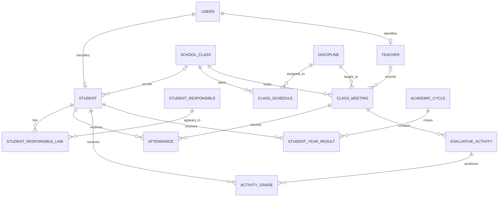

# PostgreSQL data model

Audience / owner role — backend and data engineers

Status / scope — schema produced by the committed SQL migrations through V24

Source baseline — backend `6b37a18`, 23 versioned SQL files in [db/migration](../../db/migration)

## Entities and relationships

All 27 domain tables are in schema `sisges`. Integer `id` is the primary key except for the link and timetable tables with composite keys shown below. References to a user identify a login account. References to a teacher or student identify a role profile with its own independent ID. One database contains a single school-wide academic configuration and no tenant key. [Base schema](../../db/migration/V1__create_schema_and_tables.sql) · [Grading and cycle](../../internal/api/grading.go)



### Accounts, enrollment and curriculum

| Table | Key, role and relationships |
| --- | --- |
| `users` | One identity with unique `email` and `register`, bcrypt password hash, name, birth date, gender, role and optional profile image path. SQL permits ADMIN, TEACHER and STUDENT. Soft deletion leaves both unique keys reserved. |
| `student`, `teacher` | Each table has its own unique `user_id` FK with physical cascade. Each student has a nullable current `class_id`. Physical class removal sets this FK to null. Registration creates the profile for the user's role in the same transaction. |
| `student_responsible`, `student_responsible_link` | A guardian has a name, primary phone and email and optional alternate contacts. The link's PK is `(student_id, responsible_id)`. Both FKs cascade on physical deletion. Multiple guardians and shared guardians are representable. A guardian has no login role here. |
| `document_type`, `student_document` | Catalog entries have unique names. A student can have many document metadata records, each referring to a type and holding optional number, issuer and issue date. The final schema omits the old document file path. |
| `school_class` | A class has a unique `(name, academic_year)` plus `schedule_revision`, initially zero. `academic_year` is a grade-level label up to 30 characters, for example `6º ano`. Calendar-year state lives in the academic cycle. |
| `discipline`, `discipline_teacher` | Discipline names are unique. The junction PK `(discipline_id, teacher_id)` allows multiple teachers per discipline. |
| `teacher_class`, `class_discipline` | Junction PKs are `(teacher_id, class_id)` and `(class_id, discipline_id)`. Each supports soft-deleted links. Linking a teacher with selected subjects reactivates or creates the relevant links atomically. Teaching assignments are inferred from these relations and `discipline_teacher`. |
| `lesson`, `discipline_material` | `lesson` is an ordered curriculum item belonging to a discipline. `discipline_material` holds title, description, type, optional file path, optional teacher and optional class. Materials and dated class meetings have separate IDs and storage. |
| `user_logs` | User-linked action codes 0–4 represent delete, create, update, login and logout. The migrations define the table. The Go handlers at this revision provide no general action-log writer. |

[Accounts and curriculum](../../db/migration/V1__create_schema_and_tables.sql) · [Soft deletion and logs](../../db/migration/V3__school_class_year_only_soft_delete_user_logs_remove_file_path.sql) · [Guardian links](../../db/migration/V5__student_multiple_responsibles.sql) · [Discipline assignments](../../db/migration/V8__discipline_teacher_many_to_many.sql) · [Material scope](../../db/migration/V10__discipline_material_file_class_teacher.sql) · [Atomic teacher assignment](../../internal/api/class_teacher.go)

### Teaching, assessment and school communications

| Table | Key, role and relationships |
| --- | --- |
| `class_schedule` | Recurring subject by `(class_id, weekday, slot)` PK. SQL constrains weekday to 1–5 and slot to 0–4. FK references to class and discipline do not encode class-subject membership. |
| `class_meeting` | Each occurrence has a class, subject, date, required start/end time and optional teacher. A scheduled record includes nullable `schedule_slot`, text content and JSONB attachments defaulting to an empty array. A partial unique index covers active non-null `(class_id, meeting_date, schedule_slot)`. Legacy manual meetings have a null slot. |
| `attendance` | One row per unique `(class_meeting_id, student_id)`, with presence and a soft-delete timestamp. |
| `evaluative_activity` | Each activity belongs to one meeting. It carries a nullable trimester 1–3, activity type, maximum points, optional file path, release flag, release time and optional releasing user. |
| `activity_grade` | Unique `(activity_id, student_id)`. The score is nullable numeric(8,2). SQL enforces a nonnegative score when present. Physical removal of the activity or student cascades. |
| `grading_config` | Year and trimester point maxima, minimum percentages and category allocations for exams, activities and assignments. The application reads and updates the lowest-ID row. |
| `academic_cycle` | Start/end dates, trimester 1–3, grading-lock marker and timestamps. Allowed states are `NOT_STARTED`, `IN_PROGRESS` and `FINISHED`. The application selects the lowest-ID row here too. |
| `student_year_result` | Unique `(academic_cycle_id, student_id)` stores base, final and annual recovery scores, approval/promotion and the source/optional destination class. The source FK restricts physical deletion. The destination FK uses SET NULL. |
| `announcement` | Text/image post with nullable creator FK, optional image path, activation dates and CSV role fields. Feed reads use the visibility window and `hidden_for_roles`. The legacy `target_roles` field remains available as metadata. |
| `announcement_like`, `announcement_comment` | User and announcement are FKs in both tables. Likes are unique per announcement and user. Comments have their own text and soft-delete timestamp. Physical deletion of the announcement cascades to both. |
| `school_event` | Required creator, title, timestamp and audience. SQL requires a class for `CLASS` and a null class for `ALL` or `TEACHERS`. The endpoint validates the allowed date window against the São Paulo civil year. |

[Timetables](../../db/migration/V24__weekly_timetable_and_lesson_records.sql) · [Assessments](../../db/migration/V18__grade_domain_and_academic_cycle.sql) · [Year results](../../db/migration/V19__student_year_result.sql) · [Feed reads](../../internal/api/content.go) · [Events](../../db/migration/V22__user_profile_image_and_events.sql) · [Event date handling](../../internal/api/event_date.go)

## Invariants and transaction boundaries

| Rule | Where it is enforced |
| --- | --- |
| Role-specific profiles and student guardian at registration | Registration validates the input, locks per registration prefix with `pg_advisory_xact_lock` and writes the user, profile and guardian link in one transaction. SQL independently enforces role enum, FK and key uniqueness. [Registration](../../internal/api/users.go) |
| One weekly schedule writer at a time per class | A class-row lock serializes schedule and lesson saves. A stale schedule revision fails before weekly rows are replaced. A new meeting requires active links, matching subject and no overlapping active meeting. Editing an existing scheduled record checks teacher ownership and recorded subject. [Schedules](../../internal/api/schedules.go) |
| Scores and release | The grade handler checks class membership and the activity maximum for non-null scores, then upserts all submitted entries in a transaction. The released flag is read before the transaction. The separate release endpoint updates the activity directly. Concurrent release and grade writes have no shared release lock in these handlers. [Grade writes](../../internal/api/activities.go) |
| Results and repeat closure | Year-end processing reads up to 10,000 enrolled students, applies promotion and writes result rows in one transaction. The cycle transition to FINISHED is a separate update. If results already exist for the chosen cycle, processing returns early. Starting another year updates the same lowest-ID cycle. Multi-year historical processing needs a distinct cycle identity before it can safely reuse this model. [Cycle transitions](../../internal/api/grading.go) · [Result processing](../../internal/api/report.go) |
| Grading policy and historical reporting | SQL seeds minimum-percentage columns. The report and promotion code uses 70% of the configured maximum for the relevant recovery and pass calculations. The current report aggregates the student's current class. The activity table has no cycle FK. Interpreting reports as archived per-cycle transcripts would require a different query/model. [Seed configuration](../../db/migration/V14__grading_config.sql) · [Report calculation](../../internal/api/report.go) |

## Migration lifecycle and verification

| Versions | Changes to preserve when interpreting historical data |
| --- | --- |
| V1–V3 | Create base entities, seed six document types, remove the class period, add soft-deletion fields and user logs, remove the original student-document and material file paths. |
| V4–V8 | Allow alternate guardian contacts to be null, backfill guardian links and drop the single guardian FK. Expand the grade-level label, introduce meeting times and teacher, then move the discipline's teacher assignment to its junction. |
| V9–V13 | Add announcements, reintroduce material file paths with class/teacher scope, add evaluative activities, likes, comments and hidden-role visibility. |
| V14–V17 | Seed grading policy and allocate trimester points across categories. The committed sequence skips V16. V17 installs historical E2E fixtures, subsequently cleaned by V21. |
| V18–V21 | Add grade/release and cycle fields, yearly results and the initial cycle row. V21 removes the former test user and conditionally removes associated fixture records. |
| V22–V24 | Add profile images, calendar events, active-record query indexes, weekly timetable and dated lesson fields. Existing meetings keep a null slot. |

Startup finds numeric `V<number>__<name>.sql` files, sorts by number, and creates `sisges.go_schema_migrations` if needed. A version already recorded there, or recorded as successful in the optional legacy `sisges.flyway_schema_history`, is skipped. Each remaining file and its ledger insert commit together. A failure rolls back that file and stops startup. Earlier successful files stay committed. The Go ledger tracks version, filename and application time. The runner compares versions alone and has no down migration or cross-process startup lock. Ship schema corrections in a new version. [Migration runner](../../internal/api/migrate.go) · [SQL history](../../db/migration)

For read-only inspection of an installation, check its ledger and the V24 index definition. On an upgraded database, also check successful Flyway versions when interpreting absent Go ledger entries. The PostgreSQL integration test exercises the legacy-history case in an isolated database. [Migration integration test](../../internal/api/integration_test.go)

```sql
SELECT version, name, applied_at
FROM sisges.go_schema_migrations ORDER BY version;

SELECT to_regclass('sisges.flyway_schema_history') AS legacy_history;

SELECT indexdef
FROM pg_indexes
WHERE schemaname = 'sisges' AND indexname = 'class_meeting_schedule_day';
```

## Data handling

Account details, guardian contacts, document numbers, attendance and individual scores are identifiable school records. Soft deletion sets a timestamp and typically removes a row from active queries. It leaves the data and unique keys in place. The announcement and event delete handlers physically remove rows. The expiry worker also physically removes expired posts and attempts object cleanup. Cleanup of referenced images is best effort, and R2 bytes have no database FK. The schema does not define retention periods, cross-store erasure guarantees or a per-school export boundary. These require a product and operations decision for the installation. [Content handlers](../../internal/api/content.go) · [Expiry loop](../../internal/api/websocket.go) · [Stored-file lifecycle](../../internal/api/storage.go)

## Review triggers

Update the affected entity rows, invariants and migration history when adding SQL versions, changing enrollment or grading rules, altering physical deletion, or introducing tenant or cycle keys. Recheck the diagram and lifecycle descriptions against both a fresh schema and the supported upgrade path. [System architecture](system.md) · [Timetable decision](adr-001-weekly-timetable.md)
