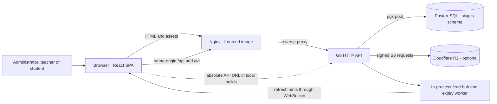

# System architecture

Audience / owner role — application engineers and service operators

Status / scope — implemented architecture and deployment assumptions

Source baseline — Go API `6b37a18`, React client `b58d2df`

## Context and boundaries

SISGES serves school administrators, teachers and students through a browser application. Two repositories produce two independently deployable images. PostgreSQL owns the academic records. The Go API mediates database and object access. The schema has one set of school-wide settings and globally scoped identities. A shared installation serving unrelated schools would require an explicit isolation design. [Data model](data-model.md)

| Component | Responsibility and boundary |
| --- | --- |
| Browser | React Router selects routes in a protected shell. React contexts manage session, theme, dialogs, toasts and timetable drafts. Drafts are keyed by user and class in memory. They survive route changes and disappear on reload or logout. Domain services call the API and map its shapes into typed UI state. [UI routes](https://github.com/SISGES/sisges-react-app/blob/b58d2dfa6eb06dba6e3485325f2087dc5538c2dc/src/App.tsx) · [Draft provider](https://github.com/SISGES/sisges-react-app/blob/b58d2dfa6eb06dba6e3485325f2087dc5538c2dc/src/contexts/TimetableDraftProvider.tsx) |
| Web server | Vite builds a static bundle with the API base embedded. Nginx serves SPA routes with an index fallback and proxies `/api/` and WebSocket upgrades to its configured backend hostname. [Frontend image](https://github.com/SISGES/sisges-react-app/blob/b58d2dfa6eb06dba6e3485325f2087dc5538c2dc/Dockerfile) · [Proxy configuration](https://github.com/SISGES/sisges-react-app/blob/b58d2dfa6eb06dba6e3485325f2087dc5538c2dc/nginx.docker.conf) |
| API | One Go process registers HTTP method/path patterns, role middleware and domain handlers. Handlers perform SQL through pgx, including additional relationship checks where required. Its process owns live socket connections and a periodic worker. [Router and pool](../../internal/api/app.go) · [Identity middleware](../../internal/api/auth.go) |
| Durable stores | PostgreSQL contains accounts, class membership, schedules, assessments, communication and file references. R2 stores uploaded images and lesson attachments. The API signs object requests using server credentials and streams downloads. [Schema](data-model.md) · [Storage adapter](../../internal/api/storage.go) |

## Critical flows

**Authentication.** Login checks the active account and bcrypt hash, then issues an HS256 token. The browser stores the token and user summary in local storage. On protected HTTP calls the API verifies signature, expiration and account identity against PostgreSQL, then applies the route role check. The feed read permits anonymous access under its student visibility rule. The WebSocket upgrade authenticates separately. Route guards control browser navigation. [Login](../../internal/api/users.go) · [Authorization](../../internal/api/auth.go) · [Feed query](../../internal/api/content.go)

**Session restoration.** The client validates a cached token during startup. At the cited revisions, the server returns an empty HTTP 200 for validation and the committed frontend GET helper attempts to parse JSON. The resulting parse failure leads the auth service to clear the cached session. A successful login in one page load therefore does not establish that session restoration works on refresh. [Validation response](../../internal/api/users.go) · [GET helper](https://github.com/SISGES/sisges-react-app/blob/b58d2dfa6eb06dba6e3485325f2087dc5538c2dc/src/services/api.ts) · [Session service](https://github.com/SISGES/sisges-react-app/blob/b58d2dfa6eb06dba6e3485325f2087dc5538c2dc/src/services/authService.ts)

**Timetable to lesson.** An administrator saves the entire class timetable with its observed revision. The API locks the class row, checks the revision and subject assignments, replaces the weekly slots and increments the revision in one transaction. A stale save returns a business error before replacement. A linked teacher requests the class day. The API combines eligible scheduled slots with the teacher's recorded lessons. Saving a lesson locks the same class row and inserts a dated meeting or updates the existing owner's record. A saved meeting retains its identity, subject, attendance and activities when the schedule changes. [Schedule handlers](../../internal/api/schedules.go) · [Decision record](adr-001-weekly-timetable.md)

**Feed changes.** Creating, updating or deleting an announcement emits a small message containing its ID and change type. Once a minute the worker deletes expired announcements and sends deletion hints. Subscribers to `/topic/feed` receive hints from the process handling the change. The browser subscribes with StompJS 7.3.0 and registers a debounced HTTP refresh callback. The Go MESSAGE frame omits the subscription ID that StompJS uses to dispatch to that callback, so this client cannot rely on an immediate refresh even with a connected socket. The server holds up to 256 clients and buffers eight outgoing messages per client. A full client queue drops a hint. A new connection receives subsequent hints with no history replay. The browser reads on mount and polls the HTTP feed every 60 seconds while the tab is visible. [Hub and expiry loop](../../internal/api/websocket.go) · [Feed component](https://github.com/SISGES/sisges-react-app/blob/b58d2dfa6eb06dba6e3485325f2087dc5538c2dc/src/components/AnnouncementFeed/AnnouncementFeed.tsx)

**Upload to download.** A permitted user sends multipart data. The API limits the file to 10 MiB, spools it to a temporary file while hashing, checks destination and extension, then uploads to R2 and returns an API path. A subsequent domain write references that path. Lesson attachments use an uploader-specific prefix and the saved lesson contains name/path metadata. A reader requests the protected API URL. Lesson-file authorization uses administrator or uploader identity, or a recorded meeting and its teacher or enrolled student. Image downloads require a valid session. If the domain write fails after upload, the object may remain unreferenced. Database commits and R2 writes have separate lifecycles. [Object operations](../../internal/api/storage.go) · [Lesson writes](../../internal/api/schedules.go)

## Deployment and operating limits

- **Startup.** The binary loads configuration, sets a Go memory target (160 MiB by default) and GC percentage (75), pings PostgreSQL, validates the optional R2 configuration, applies migrations, optionally seeds demonstration data, then listens for HTTP. A startup error prevents serving traffic. A one-second database ping powers `GET /health`. An unavailable R2 service can therefore coexist with a healthy database check. [Process entry point](../../cmd/sisges/main.go) · [Configuration](../../internal/api/config.go) · [Application startup](../../internal/api/app.go)
- **Resources.** Each process defaults to six database connections, zero minimum connections and a two-minute idle lifetime. The configurable range is 1–32. The standard JSON decoder limits bodies to 1 MiB. The R2 client uses a 45-second timeout. The non-root runtime image includes the binary, migration files, CA certificates and a writable temporary directory. Its Go memory target is a soft limit. [Pool and JSON decoder](../../internal/api/app.go) · [Storage](../../internal/api/storage.go) · [API image](../../Dockerfile)
- **Routing assumptions.** The checked-in local Compose example names the API service `backend`. The frontend's Nginx upstream is `sisges-backend:8080`, which requires a resolvable service name or network alias even when browser API calls use an absolute URL. Deployment builds set `VITE_API_BASE_URL=/api`. The socket URL builder at the pinned revision assumes an absolute URL and loses the host with that relative value. Check both HTTP and a live announcement update through the actual ingress. TLS termination and the remote host's Compose configuration are outside these two repositories. [Local Compose](../../docker-compose.yml) · [Nginx upstream](https://github.com/SISGES/sisges-react-app/blob/b58d2dfa6eb06dba6e3485325f2087dc5538c2dc/nginx.docker.conf) · [Socket URL builder](https://github.com/SISGES/sisges-react-app/blob/b58d2dfa6eb06dba6e3485325f2087dc5538c2dc/src/hooks/useStompFeed.ts) · [Frontend deployment](https://github.com/SISGES/sisges-react-app/blob/b58d2dfa6eb06dba6e3485325f2087dc5538c2dc/.github/workflows/deploy.yml)
- **Rollout.** The repositories' deploy workflows publish images and invoke Compose on a remote EC2 host independently. When a browser change requires a new handler or schema, make the API revision ready first. The backend checks migration version history before a transaction per pending file. Concurrent startups against unapplied migrations can race, so serialize schema-changing startups. [Backend deployment](../../.github/workflows/deploy.yml) · [Migration runner](../../internal/api/migrate.go)
- **Replication.** Additional API processes multiply database pools and start additional expiry workers. Live notifications reach clients attached to the emitting process. A future multi-instance design needs coordinated migration execution, a connection budget and a cross-instance feed delivery decision. These are design considerations for expansion. [Hub](../../internal/api/websocket.go) · [Pool initialization](../../internal/api/app.go)

## Review triggers

Review this document with the data model and API reference when changing the identity or school boundary, adding a shared broker, updating frontend API resolution, changing storage authorization, or splitting the Go process. The timetable decision records which invariants a new writer must preserve. [Data model](data-model.md) · [API reference](../api/README.md) · [Timetable decision](adr-001-weekly-timetable.md)
