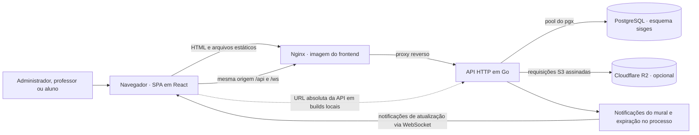

# Arquitetura do sistema

Público e responsabilidade — engenharia de aplicação e operação do serviço

Situação e escopo — arquitetura implementada e premissas de implantação

Revisões de referência — API em Go `6b37a18`, cliente React `b58d2df`

## Contexto e limites

O SISGES atende administradores escolares, professores e alunos pelo navegador. Dois repositórios produzem imagens que podem ser implantadas de forma independente. O PostgreSQL armazena os registros acadêmicos. A API em Go intermedeia o acesso ao banco e aos objetos. O esquema tem uma configuração escolar compartilhada e identidades de alcance global. Uma instalação compartilhada por escolas independentes exigiria um projeto de isolamento explícito. [Modelo de dados](data-model.md)

| Componente | Responsabilidade e limites |
| --- | --- |
| Navegador | O React Router seleciona as rotas dentro da área protegida. Contextos do React gerenciam sessão, tema, diálogos, notificações e rascunhos da grade. Os rascunhos ficam na memória por usuário e turma, persistem na navegação e são descartados ao recarregar a página ou sair da conta. Os serviços de domínio chamam a API e convertem as respostas em estado tipado para a interface. [Rotas da interface](https://github.com/SISGES/sisges-react-app/blob/b58d2dfa6eb06dba6e3485325f2087dc5538c2dc/src/App.tsx) · [Contexto dos rascunhos](https://github.com/SISGES/sisges-react-app/blob/b58d2dfa6eb06dba6e3485325f2087dc5538c2dc/src/contexts/TimetableDraftProvider.tsx) |
| Servidor web | O Vite gera arquivos estáticos com a URL base da API incorporada. O Nginx serve as rotas da SPA usando a página inicial como fallback e encaminha as chamadas a `/api/` e as solicitações de conexão WebSocket ao endereço configurado do backend. [Imagem do frontend](https://github.com/SISGES/sisges-react-app/blob/b58d2dfa6eb06dba6e3485325f2087dc5538c2dc/Dockerfile) · [Configuração do proxy](https://github.com/SISGES/sisges-react-app/blob/main/nginx.docker.conf) |
| API | Um processo Go registra métodos e caminhos HTTP, middleware de autorização por papel e funções de domínio. Essas funções executam SQL por meio do pgx e verificam vínculos adicionais quando a operação exige. O mesmo processo mantém as conexões de socket e executa uma rotina periódica. [Rotas e pool de conexões](../../internal/api/app.go) · [Middleware de identidade](../../internal/api/auth.go) |
| Armazenamento persistente | O PostgreSQL guarda contas, vínculos com turmas, grades horárias, avaliações, comunicações e referências a arquivos. O R2 guarda imagens enviadas e anexos de aulas, materiais e atividades. A API assina as requisições aos objetos com credenciais do servidor e transmite os arquivos em fluxo contínuo. [Esquema](data-model.md) · [Adaptador de armazenamento](../../internal/api/storage.go) |

## Fluxos críticos

**Autenticação.** No login, a API verifica a conta ativa e o hash bcrypt da senha e emite um token HS256. O navegador guarda o token e um resumo do usuário no armazenamento local. Nas chamadas HTTP protegidas, a API valida a assinatura e a expiração, confere a identidade da conta no PostgreSQL e aplica a regra de papel da rota. A leitura do mural exige autenticação e respeita o período e os papéis ocultos de cada aviso. A conexão WebSocket tem autenticação própria durante o upgrade. Os controles de rota orientam a navegação no cliente. [Login](../../internal/api/users.go) · [Autorização](../../internal/api/auth.go) · [Consulta do mural](../../internal/api/content.go)

**Restauração da sessão.** Ao iniciar, o cliente valida o token guardado. A API responde com HTTP 200 sem corpo quando o token é válido. O cliente usa o status para manter a sessão e limpa o armazenamento local quando a validação falha. [Resposta de validação](../../internal/api/users.go) · [Serviço de sessão](https://github.com/SISGES/sisges-react-app/blob/main/src/services/authService.ts)

**Da grade ao registro de aula.** O administrador salva a grade completa da turma com a revisão que consultou. Em uma transação, a API bloqueia a linha da turma, verifica a revisão e os vínculos das disciplinas, substitui os horários semanais e incrementa a revisão. Se ela estiver desatualizada, retorna um erro de negócio antes da substituição. Quando o professor vinculado consulta a turma por data, a API combina os horários que ele pode lecionar e as aulas que ele já registrou. Ao salvar, a API bloqueia a mesma turma e insere uma aula naquela data ou atualiza o registro do próprio professor. A aula registrada conserva o identificador, a disciplina, a frequência e as atividades mesmo que a grade mude. [Operações da grade](../../internal/api/schedules.go) · [Registro de decisão](adr-001-weekly-timetable.md)

**Alterações no mural.** Criar, atualizar ou excluir um aviso gera uma mensagem com seu ID e o tipo de alteração. A cada minuto, a rotina de expiração remove avisos vencidos e sinaliza as exclusões. Os assinantes de `/topic/feed` recebem as notificações emitidas pelo processo que tratou a alteração. O navegador usa StompJS 7.3.0 e registra uma função que agrupa notificações próximas antes de atualizar o mural por HTTP. O quadro MESSAGE inclui o ID da assinatura que a biblioteca usa para acionar a função. A consulta periódica por HTTP recupera o estado quando uma notificação se perde. O servidor aceita até 256 clientes e reserva espaço para oito mensagens de saída por cliente. Se a fila estiver cheia, a notificação se perde. Uma nova conexão recebe apenas as próximas notificações, sem reprodução do histórico. O navegador consulta o mural ao exibir o componente e a cada 60 segundos enquanto a aba estiver visível. [Distribuição de notificações e expiração](../../internal/api/websocket.go) · [Componente do mural](https://github.com/SISGES/sisges-react-app/blob/b58d2dfa6eb06dba6e3485325f2087dc5538c2dc/src/components/AnnouncementFeed/AnnouncementFeed.tsx)

**Envio e leitura de arquivos.** Um usuário autorizado envia dados multipart. A API limita o arquivo a 10 MiB, grava-o temporariamente enquanto calcula o hash, verifica destino e extensão, envia o objeto ao R2 e devolve um caminho da API. Uma gravação de domínio posterior referencia esse caminho. Os anexos de aula usam um prefixo por usuário remetente e o registro da aula guarda nome e caminho. O leitor solicita a URL protegida da API. Podem ler o anexo o administrador, quem fez o envio e, pelo vínculo com uma aula registrada, o professor da aula ou um aluno matriculado na turma. Imagens exigem sessão válida. Se a gravação do registro falhar após o envio, o objeto pode ficar sem referência. O banco e o R2 confirmam suas gravações separadamente. [Operações com objetos](../../internal/api/storage.go) · [Gravação de aulas](../../internal/api/schedules.go)

## Implantação e limites operacionais

- **Inicialização.** O binário carrega a configuração, define a meta de memória do Go (160 MiB por padrão) e o percentual do coletor de lixo (75), testa a conexão com o PostgreSQL, valida a configuração opcional do R2, aplica as migrações e, quando habilitado, insere dados de demonstração. Só então começa a atender por HTTP. Um erro na inicialização impede o atendimento. `GET /health` testa a conexão com o banco com limite de um segundo. A verificação pode passar mesmo quando o R2 está indisponível. [Entrada do processo](../../cmd/sisges/main.go) · [Configuração](../../internal/api/config.go) · [Inicialização da aplicação](../../internal/api/app.go)
- **Recursos.** Por padrão, cada processo usa um pool com máximo de seis conexões, mínimo de zero e limite de dois minutos de ociosidade. O máximo é configurável de 1 a 32. O decodificador JSON padrão limita o corpo a 1 MiB. O cliente do R2 tem limite de 45 segundos por requisição. A imagem de execução usa um usuário sem privilégios de root e inclui o binário, as migrações, certificados de autoridades certificadoras e um diretório temporário gravável. A meta de memória do Go é flexível. [Pool e decodificador JSON](../../internal/api/app.go) · [Armazenamento](../../internal/api/storage.go) · [Imagem da API](../../Dockerfile)
- **Roteamento.** O exemplo local do Compose dá ao serviço da API o nome `backend`. O Compose de desenvolvimento fornece o alias `sisges-backend`, que o Nginx usa para alcançar a API na rede de contêineres. Na compilação para implantação, usa-se `VITE_API_BASE_URL=/api`. A URL do socket é resolvida a partir da origem atual quando a base é relativa. Verifique pelo ponto de entrada real tanto o HTTP quanto uma atualização de aviso em tempo real. A terminação TLS e o Compose do servidor remoto são configurados fora destes repositórios. [Compose local](../../docker-compose.yml) · [Destino do Nginx](https://github.com/SISGES/sisges-react-app/blob/main/nginx.docker.conf) · [Montagem da URL do socket](https://github.com/SISGES/sisges-react-app/blob/main/src/hooks/useStompFeed.ts) · [Implantação do frontend](https://github.com/SISGES/sisges-react-app/blob/b58d2dfa6eb06dba6e3485325f2087dc5538c2dc/.github/workflows/deploy.yml)
- **Publicação.** Cada repositório publica imagens Docker a partir de main. O operador aplica as imagens no VPS, com o backend primeiro. Quando o frontend precisa de uma nova operação ou esquema, disponibilize primeiro a revisão da API. O backend consulta o histórico de migrações e abre uma transação para cada arquivo pendente. Inicializações concorrentes podem disputar a aplicação da mesma versão. Execute em sequência as inicializações que modificam o esquema. [Publicação e implantação](../operations/release.md) · [Executor de migrações](../../internal/api/migrate.go)
- **Réplicas.** Cada processo adicional da API cria outro pool de banco e outra rotina de expiração. As notificações em tempo real chegam aos clientes conectados ao processo emissor. Uma futura implantação com várias instâncias precisa coordenar a execução de migrações, dimensionar o total de conexões e definir como distribuir as notificações entre processos. [Distribuição do mural](../../internal/api/websocket.go) · [Inicialização do pool](../../internal/api/app.go)

## Quando revisar

Revise este documento, o modelo de dados e a referência da API ao mudar os limites de identidade ou de escola, adicionar um intermediário de mensagens compartilhado, alterar a resolução da URL da API pelo frontend, mudar a autorização de arquivos ou dividir o processo Go. A decisão sobre a grade descreve as invariantes que qualquer nova operação de gravação deve preservar. [Modelo de dados](data-model.md) · [Referência da API](../api/README.md) · [Decisão sobre a grade](adr-001-weekly-timetable.md)
